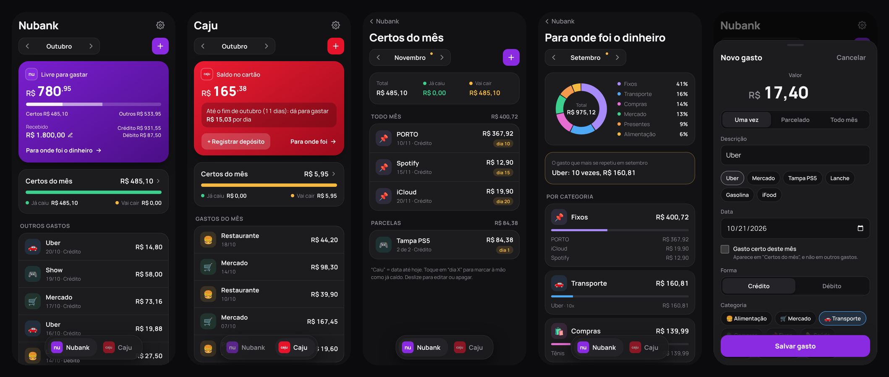

# Gastos: controle dos cartões Nubank e Caju


Aplicativo web instalável no iPhone (PWA) para controlar os gastos do dia a dia em dois cartões:
o **Nubank** (salário) e o **Caju** (benefício da empresa). Ele substitui a planilha do Excel que
eu usava e responde, a qualquer momento, duas perguntas: **quanto ainda está livre** no Nubank
neste mês e **quanto tem de saldo** no Caju.

É um projeto pessoal e de portfólio, feito com a mesma base do
[app da doceria](https://github.com/lucashsjc/APP-DOCERIA).



<sub>Telas do modo demonstração, com dados fictícios.</sub>

---

## O problema

Eu controlava os gastos numa planilha do Excel: um bloco por mês, cada gasto numa coluna com
data, descrição e valor, mais o valor recebido no mês. Isso trazia dificuldades:

- abrir a planilha no celular para lançar um Uber de R$ 17 era lento, então eu deixava para
  depois e esquecia;
- os gastos que se repetem (seguro, Spotify, iCloud) e as parcelas eu copiava à mão nos meses
  seguintes;
- o cartão Caju, que recebe depósitos sem dia fixo, não era controlado;
- para saber quanto ainda podia gastar no mês, eu fazia a conta de cabeça.

## A solução

Um app simples, com uma aba para cada cartão e os dados na nuvem, que só eu acesso. Registrar
um gasto leva poucos toques, e o app faz as contas que eu fazia à mão. A descrição completa do
que foi decidido está em [`docs/superpowers/specs`](docs/superpowers/specs/2026-10-21-app-gastos-design.md).

## Funcionalidades

**Aba Nubank**
- **Livre para gastar** no mês = recebido − certos do mês − outros gastos (fica vermelho se
  passar do recebido).
- Quanto foi no crédito e quanto no débito, e o valor recebido do mês, editável.
- **Certos do mês**: o que já se sabe que vai cair (todo mês, parcelas e gastos só deste mês),
  separado em **já caiu** e **vai cair**.

**Aba Caju**
- **Saldo no cartão**, que acumula de um mês para o outro, e **quanto dá para gastar por dia**
  até o fim do mês.
- Registro dos depósitos do benefício (valor e data), já que não há dia fixo.
- Num mês passado, mostra o saldo no fim daquele mês; num mês futuro, o saldo previsto.

**Registrar e editar**
- Botão **+** no topo, ao lado do seletor de mês, que abre uma folha de baixo para cima:
  valor em destaque, sugestões das descrições mais usadas, data, categoria e tipo
  (**Uma vez**, **Parcelado** ou **Todo mês**).
- O app lembra a categoria e a forma (crédito ou débito) usadas da última vez em cada descrição.
- Deslizar um gasto para a esquerda mostra **Editar** e **Apagar**, com a confirmação na própria
  linha.
- Mudar o valor de um gasto de todo mês vale do mês atual em diante; os meses passados não mudam.

**Para onde foi o dinheiro**
- Gráfico de rosca por categoria, os principais gastos de cada categoria, barras dos últimos
  meses e o gasto que mais se repetiu ("Uber: 10 vezes, R$ 160,81").

**Faculdade** (pelo menu ☰, junto com Trabalho, Banco e Projetos)
- **Notas** por disciplina, com média ponderada e aviso de acima ou abaixo da média mínima.
- **Faltas** por disciplina, com o limite, quantas aulas ainda pode perder e o botão "Faltei hoje".
- **Atividades** com data de entrega: atrasadas, para hoje e próximas, e marcar como entregue.

**Planilha**
- **Importar** o histórico da planilha antiga, lida no próprio celular, com um resumo antes de
  gravar. Os meses futuros viram sugestões de gastos certos (todo mês ou parcela), que eu confirmo.
  Importar de novo não duplica nada.
- **Exportar** todos os dados (gastos e faculdade) num arquivo .xlsx, como cópia de segurança.

## Tecnologias

| Camada | Tecnologia |
| --- | --- |
| Interface | React 19, TypeScript, React Router, CSS próprio (sem framework de UI), fonte Manrope |
| Build e testes | Vite e Vitest |
| Banco de dados | PostgreSQL no Supabase, com migrações SQL versionadas |
| Autenticação | Supabase Auth (e-mail e senha), com o cadastro de novas contas desligado |
| Hospedagem | Vercel, com deploy automático a partir do GitHub |
| Planilhas | Leitura e escrita de .xlsx no navegador (XML próprio + [fflate](https://github.com/101arrowz/fflate) para o zip) |
| App no celular | PWA (manifest e ícones), instalado pela tela de início do iPhone |

## Decisões técnicas

- **Dinheiro em centavos inteiros.** Todos os valores são guardados e somados como números
  inteiros de centavos, nunca em ponto flutuante (`0,1 + 0,2` não vira `0,30000000000000004`).
  A conversão para reais só acontece na hora de mostrar ([`src/lib/dinheiro.ts`](src/lib/dinheiro.ts)).
- **Regras de cálculo em funções puras, com testes.** Livre, certos do mês, saldo do Caju, por
  dia, parcelas e recorrências ficam em [`src/lib/calculos.ts`](src/lib/calculos.ts), sem React
  nem banco, e são cobertas por testes automatizados. Os testes conferem os números com a
  planilha antiga: outubro com 17 gastos somando R$ 1.019,05, novembro com R$ 485,10 já certos.
- **Datas no fuso de São Paulo.** "Hoje" é calculado em `America/Sao_Paulo`, e as datas são
  texto (`AAAA-MM-DD`) somado com `Date.UTC`: um gasto feito às 23h30 do dia 31 continua no mês
  certo, qualquer que seja o fuso do aparelho.
- **Recorrências calculadas, não copiadas.** Um gasto de todo mês é uma linha só no banco (dia,
  valor, mês de início e de fim). As ocorrências de cada mês são calculadas. Editar o valor
  encerra a recorrência no mês anterior e cria outra a partir do mês atual, para o passado não
  mudar.
- **Parcelas sem centavo perdido.** O total é dividido igualmente e a sobra de centavos fica na
  primeira parcela (R$ 100,00 em 3x = 33,34 + 33,33 + 33,33). Em meses mais curtos, a parcela
  cai no último dia.
- **Segurança no banco (Row Level Security).** Todas as tabelas têm políticas
  `user_id = auth.uid()`: mesmo com a chave pública do Supabase no front-end, cada registro só é
  lido ou alterado pelo próprio dono. O banco também recusa dados inconsistentes (por exemplo,
  crédito/débito num gasto do Caju).
- **Camada de dados com duas implementações.** As telas usam uma interface `Repo`
  ([`src/data/repo.ts`](src/data/repo.ts)) com uma versão para o Supabase e outra para o
  `localStorage`. Sem as variáveis de ambiente, o app abre em **modo demonstração** com dados
  de exemplo fictícios.
- **Planilhas no navegador.** A importação lê o .xlsx no próprio celular (o arquivo não vai para
  nenhum servidor) e o teste da importação usa uma planilha sintética montada no próprio teste.
  Nenhuma planilha real entra no repositório (`*.xlsx` está no `.gitignore`).

## Estrutura do projeto

```
src/
  pages/        telas (abas Nubank e Caju, certos do mês, para onde foi, ajustes, importar, login)
  componentes/  folha de novo gasto, item deslizável, seletor de mês, ícones…
  data/         tipos, acesso a dados (Supabase ou modo demonstração) e dados de exemplo
  lib/          regras de cálculo, datas, dinheiro, categorias, .xlsx e importação (com testes)
  faculdade/    área Faculdade: notas, faltas, atividades, regras (com testes) e dados
  estado.tsx    dados carregados, mês escolhido e "hoje"
supabase/       esquema do banco (SQL) com RLS
public/         ícones e manifest do PWA
docs/           descrição do app e imagens do README
```

## Como rodar

```bash
npm install
npm run dev     # abre em http://localhost:5173
npm test        # testes das regras de cálculo e da importação
npm run lint
npm run build
```

Sem configurar o Supabase, o app abre em **modo demonstração**: tudo funciona, com dados de
exemplo fictícios que ficam só no navegador (em Ajustes dá para voltar a eles).

<details>
<summary><strong>Configurar o banco (Supabase) e publicar (Vercel)</strong></summary>

1. Crie um projeto em [supabase.com](https://supabase.com) (região São Paulo, de preferência).
2. Em **SQL Editor → New query**, cole e rode, nesta ordem,
   [`supabase/schema.sql`](supabase/schema.sql) (gastos) e
   [`supabase/003_faculdade.sql`](supabase/003_faculdade.sql) (faculdade). Eles podem rodar mais
   de uma vez sem duplicar nada. Para conferir, rode também
   [`supabase/002_conferir_rls.sql`](supabase/002_conferir_rls.sql): todas as tabelas devem
   aparecer com `rls_ligado = true`.
3. Em **Authentication → Sign In / Providers**, desligue **Allow new users to sign up**.
4. Em **Authentication → Users → Add user → Create new user**, crie o seu usuário (e-mail e
   senha, com **Auto Confirm User** marcado).
5. Copie `.env.example` para `.env.local` e preencha `VITE_SUPABASE_URL` e
   `VITE_SUPABASE_ANON_KEY` (em **Project Settings → API**). Com isso, `npm run dev` já usa o banco.
6. Na [Vercel](https://vercel.com), **Add New → Project**, importe o repositório `APP-GASTOS`
   (o Vite é detectado sozinho) e, em **Environment Variables**, adicione as mesmas duas
   variáveis. Cada push na `main` publica uma versão nova.
7. No iPhone, abra o endereço da Vercel no Safari → **Compartilhar → Adicionar à Tela de Início**.
8. No app, em **Ajustes → Importar da planilha**, escolha o `Controle Financeiro.xlsx` para
   trazer o histórico.

</details>

## Como foi desenvolvido

O projeto partiu da planilha que eu já usava. Antes de escrever código, registrei numa
[descrição](docs/superpowers/specs/2026-10-21-app-gastos-design.md) o que o app precisa fazer,
as regras de cálculo e o que ficaria de fora desta versão, e aprovei o visual em mockups.

Usei IA (Claude Code) como ferramenta de desenvolvimento. Fiquei responsável pelo levantamento
dos requisitos, pelas decisões de produto e das regras de cálculo, pela aprovação do visual, pela
configuração da infraestrutura (Supabase, Vercel, GitHub) e pela validação do app no dia a dia.

---

Autor: [@lucashsjc](https://github.com/lucashsjc)
